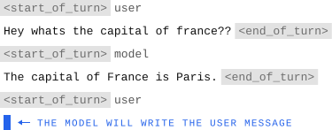

# selfgpt

LLMs are trained to only generate text in the assistant slot of their chat template, but there's nothing stopping someone from making them generate the user turns too. That's exactly what selfgpt does. It takes in a GGUF, reads its template and uses it in reverse.

The model will generate inside the user slot and your messages will fill the assistant slot. Have fun!

PS: This repo also contains an LLM-as-a-judge pipeline in `eval/` to see which model is the closest to human behaviour, you can check the results [here](https://selfgpt.pages.dev)!

<p align="center"></p>

```bash
# Clone and prepare env (Python 3.10+)
git clone https://github.com/Belluxx/selfgpt
cd selfgpt
python3 -m venv .venv
source .venv/bin/activate
pip install -r requirements.txt

# Chat in the terminal
python -m selfgpt your-model.gguf

# OpenAI-compatible API at /v1
python -m selfgpt your-model.gguf --serve --port 8000
```

## Options

| Flag | Effect |
|---|---|
| `--min-tokens N` | Force the turn to be at least N tokens |
| `--end-discourage F` | Divide the probability of ending the turn by F |
| `--no-think` | Ban the template's reasoning tokens |
| `--stop TEXT` | Also end the turn at TEXT, e.g. `"\n\n"` (repeatable) |

Many chat-tuned models are not comfortable writing user turns. Using these flags may help if you encounter some issues like early terminations etc...

## The experiment

How well do models pass as human when they write in the user slot? The results are at [selfgpt.pages.dev](https://selfgpt.pages.dev), and [docs/experiment.md](docs/experiment.md) has the evaluation and how to reproduce it.

